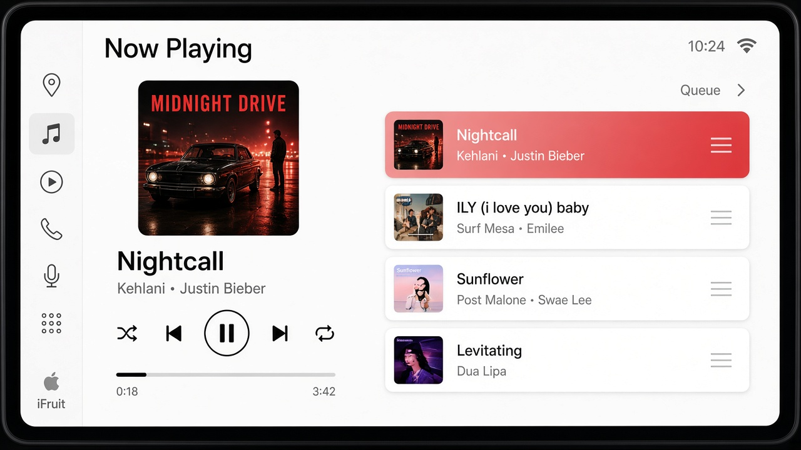
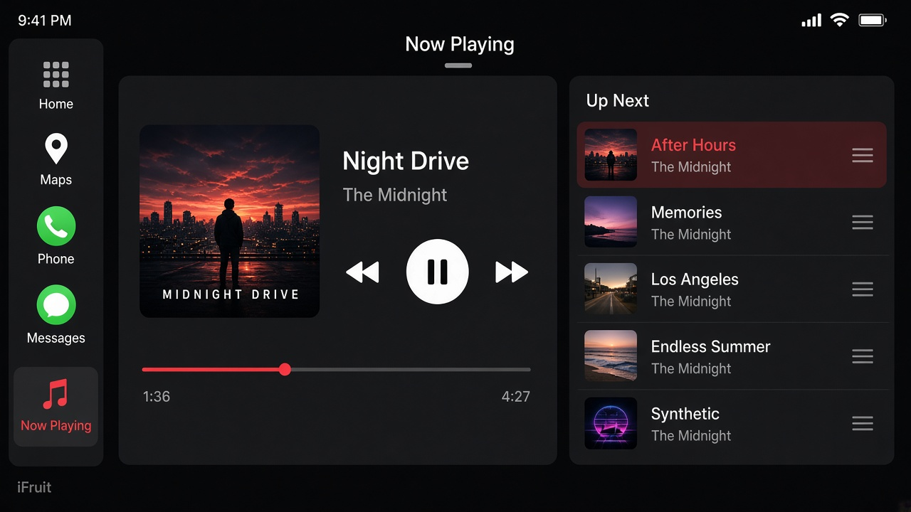
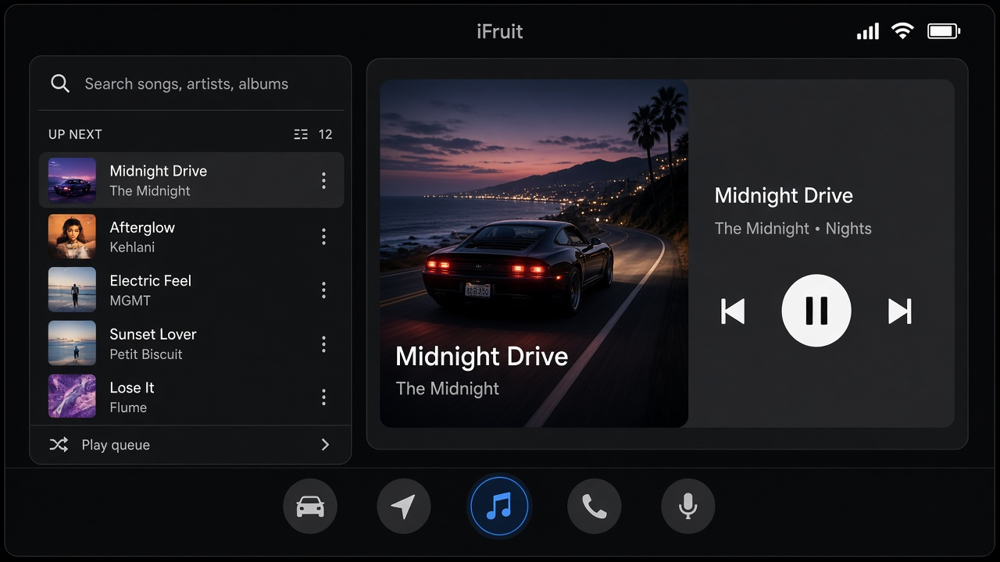
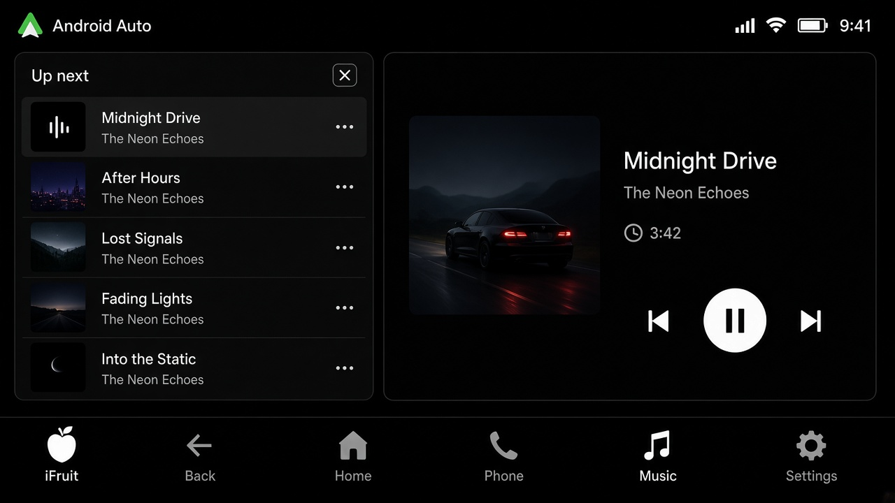
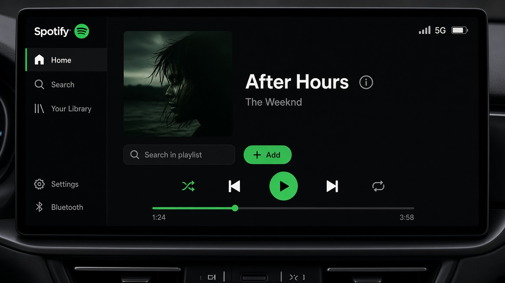

# CarPlay NUI — FiveM

Standalone CarPlay for FiveM: YouTube search and links, queue, party, GTA radios, and themes.

Open with **F7**. Driver controls the music unless you are in a party.

## Themes

| Theme | Preview |
| --- | --- |
| **CarPlay** |  |
| **CarPlay Oscuro** |  |
| **Android Auto** |  |
| **Android Auto Oscuro** |  |
| **Spotify** |  |

Also included: Aurora, Carbon, Sunset. The look is saved on the client.

## Install

1. Put the folder in `resources/[local]/carplay`
2. `ensure carplay` (needs `ox_lib` if your server already uses it for other scripts; this resource is standalone)
3. In `server.cfg`:

```cfg
ensure carplay
```

## Features

- Search songs by name or paste a YouTube / playlist link
- Queue (max 10), shuffle, repeat
- Party Music: same track for everyone
- GTA V radio stations
- Typing in search does not fire other keybinds
- High-res cover art

## Files

```
fxmanifest.lua
client.lua
server.lua
html/index.html
html/app.js
html/style.css
```
